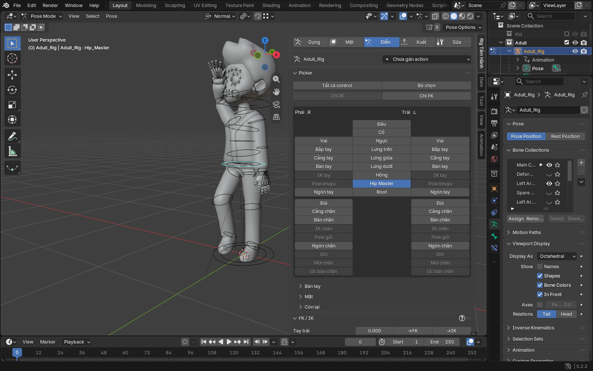
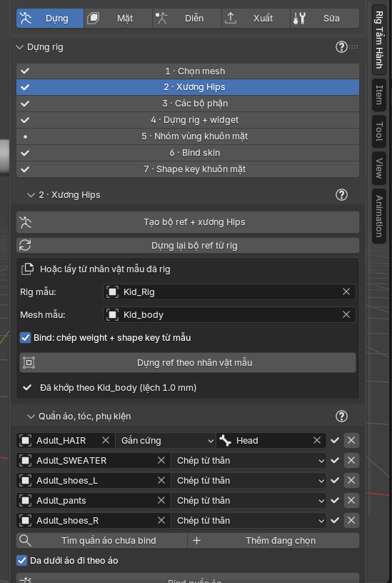
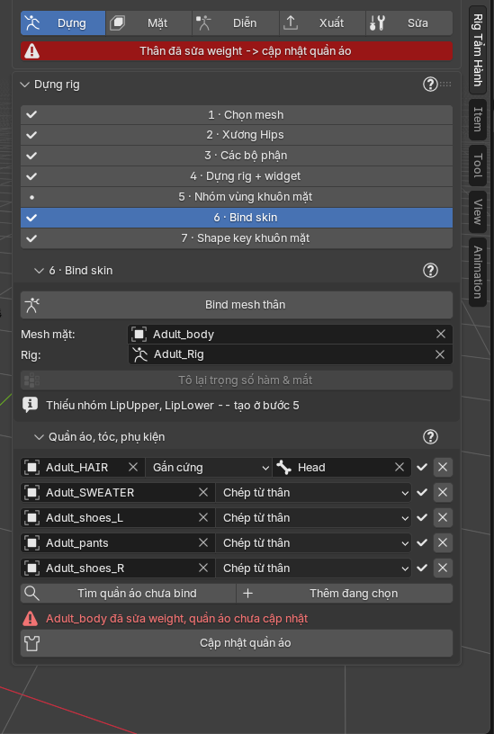
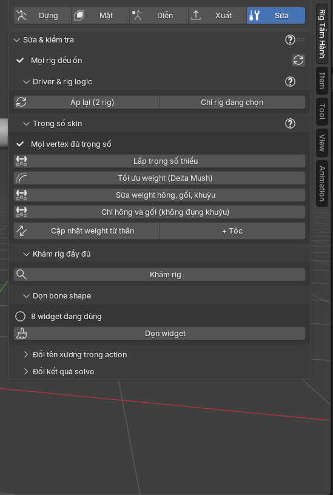
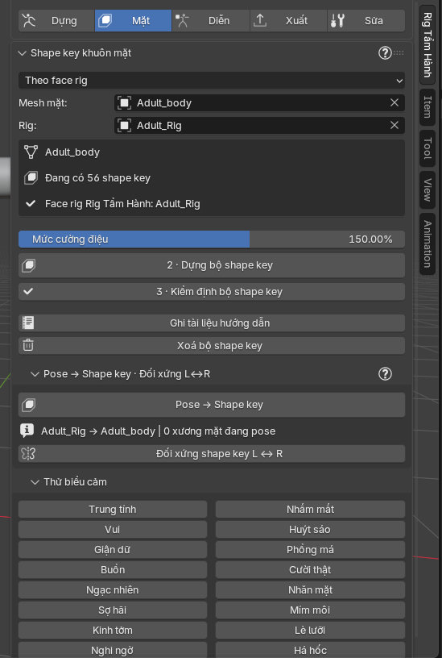

# Rig Tẩm Hành

Bộ công cụ rig nhân vật cho Blender: dựng rig từ bộ xương ref hoặc theo một nhân vật
mẫu đã rig sẵn, bind skin và quần áo, sửa và tối ưu weight, dựng shape key khuôn mặt,
công cụ diễn hoạt (picker, snap FK/IK, onion skin) và xuất sang Unity dạng Humanoid.
Chạy hoàn toàn offline, giao diện tiếng Việt.



## Tính năng chính

- **Dựng rig theo từng bước**: đặt bộ xương ref (thân, tay, bàn tay, chân, mặt, hàm, răng,
  lưỡi, môi, mũi, mắt, mí, mày, tai, chuỗi xương tự do) rồi dựng rig hoàn chỉnh — FK/IK,
  pole, công tắc, bone shape.
- **Khớp theo nhân vật mẫu**: có sẵn một nhân vật đã rig và tô weight? Addon tự khớp bộ
  xương, weight và shape key của nhân vật mẫu sang nhân vật mới.
- **Weight**: bind skin, lấp weight thiếu, dải chuyển hông / gối / khuỷu, **tối ưu weight
  bằng Delta Mush** (tối đa 4 xương mỗi vertex cho Unity), tự **giữ nguyên weight bạn vẽ
  tay**.
- **Quần áo, tóc, phụ kiện**: chép weight từ thân, gắn cứng vào xương, hoặc automatic;
  **cập nhật weight từ thân** sau mỗi lần sửa thân, có cảnh báo khi quần áo chưa cập nhật.
- **Shape key khuôn mặt**: dựng bộ shape key (âm vị, hàm, miệng, lưỡi, mắt, mày) từ xương
  mặt, biến pose thành shape key, đối xứng L↔R.
- **Diễn hoạt**: picker, chuyển và snap FK↔IK, bake theo đoạn, onion skin.
- **Xuất Unity Humanoid**: xuất FBX nhân vật + animation kèm bảng ánh xạ xương; script
  import cho Unity tự dựng Avatar, không cần map tay.
- **Sửa & kiểm tra**: khám rig, dựng lại driver/constraint, dọn bone shape, đổi tên xương
  trong action.

## Yêu cầu

- Blender 5.0 trở lên (đã dùng hằng ngày trên Blender 5.2, Windows).
- Unity 2022.3 trở lên nếu dùng phần xuất Humanoid.

## Cài đặt

1. Tải file `rig_tam_hanh-<phiên bản>.zip` ở mục **Releases** của repo.
2. Blender → **Edit → Preferences → Add-ons** → nút ⌄ góc phải → **Install from Disk…** →
   chọn file zip.
3. Tick bật **Rig Tẩm Hành**.
4. Trong cửa sổ 3D, bấm **N** để mở thanh bên, chọn tab **Rig Tẩm Hành**.

Cài từ mã nguồn: clone repo vào thư mục addons của Blender, **thư mục phải tên
`rig_tam_hanh`**:

```
git clone https://github.com/chupentamhanh/rig-tam-hanh.git "%APPDATA%\Blender Foundation\Blender\5.2\scripts\addons\rig_tam_hanh"
```

## Hướng dẫn sử dụng

Tab **Rig Tẩm Hành** chia làm 5 khu, theo đúng thứ tự làm việc:
**Dựng → Mặt → Diễn → Xuất → Sửa**. Mỗi lúc chỉ hiện panel của một khu. Vào Pose Mode thì
addon tự chuyển sang khu Diễn. Nút **?** ở mỗi panel mở hướng dẫn ngắn ngay trong Blender.

### 1. Dựng rig

Khu **Dựng** là một danh sách 7 bước. Bước đã xong có dấu ✓; bấm vào một bước để mở nó.


**Bước 1 · Chọn mesh**

- Chọn mesh thân nhân vật và đặt tên cho rig.
- Nếu mắt là object riêng: thêm vào mục *Nhãn cầu rời* (trái / phải). Mắt sẽ được gắn cứng
  vào xương mắt thay vì skin như da.
- Răng, lưỡi, lông mày là mesh riêng: thêm vào mục bên dưới với đúng vai trò.

<br clear="right">



**Bước 2 · Xương Hips** — có hai cách:

- **Tạo bộ ref + xương Hips**: bắt đầu bộ xương ref từ đầu, đặt Hips vào giữa hông.
- **Lấy từ nhân vật mẫu đã rig** (nhanh nhất nếu bạn đã có một nhân vật cùng kiểu):
  1. Chọn *Rig mẫu* và *Mesh mẫu*.
  2. Bấm **Dựng ref theo nhân vật mẫu**. Addon khớp hình nhân vật mẫu lên nhân vật mới
     (báo độ lệch trung bình, thường khoảng 1 mm) và đặt toàn bộ xương ref theo đó: vai
     theo nách, hông theo đáy quần, mặt phẳng gập gối và khuỷu theo mẫu.
  3. Giữ bật *Bind: chép weight + shape key từ mẫu*: lúc bind, weight và shape key của
     mẫu được chép sang thay cho automatic weights.

<br clear="right">

**Bước 3 · Các bộ phận** — thêm từng bộ phận ref: thân, tay, bàn tay, chân, mặt (hoặc từng
phần mặt lẻ: hàm, răng, lưỡi, môi, mũi, mắt, mí, mày, tai) và chuỗi xương tự do (đuôi, tóc
dài…). Kéo các xương ref vào đúng chỗ trên mesh.

**Bước 4 · Dựng rig + widget** — sinh rig hoàn chỉnh: xương deform, FK/IK, pole, công tắc
FK/IK, bone shape tự ôm theo thân. Muốn chỉnh vị trí xương của rig đã dựng (kể cả sau khi
bind): bấm **Dựng lại bộ ref từ rig** ở bước 2, kéo xương ref, rồi áp lại — chỉ những xương
bạn đã di chuyển thay đổi, weight giữ nguyên.

**Bước 5 · Nhóm vùng khuôn mặt** *(tuỳ chọn)* — đánh dấu môi, mí, răng… để bước bind tô
weight mặt chính xác và bước 7 dựng shape key.



**Bước 6 · Bind skin**

- **Bind mesh**: skin mesh thân vào rig (automatic weights, hoặc chép từ nhân vật mẫu).
  Xương hàm, mắt, răng được tô riêng.
- **Quần áo, tóc, phụ kiện**: bấm *Tìm quần áo chưa bind* hoặc *Thêm đang chọn*, chọn cách
  bind cho từng món:
  - *Chép từ thân* — áo, quần, giày: lấy weight của điểm gần nhất trên da, nên gập tay
    không bị đâm xuyên.
  - *Gắn cứng* — tóc ngắn, mũ, kính: 100% vào một xương.
  - *Automatic* — đồ rộng, xa thân.
- *Da dưới áo đi theo áo*: da bị quần áo che lấy weight của áo phía trên, chống đâm xuyên.
- **Cập nhật weight từ thân** *(+ Tóc)*: sau khi bạn sửa weight thân, bấm nút này để chép
  lại cho áo, quần, giày, lông mày mà **không đụng vào thân**.

<br clear="right">

**Bước 7 · Shape key khuôn mặt** — xem khu Mặt bên dưới.

### 2. Weight: sửa, tối ưu, vẽ tay



Ở khu **Sửa → Trọng số skin**:

| Nút | Dùng khi |
|---|---|
| **Lấp trọng số thiếu** | Có vertex tổng weight < 1 (đứng yên khi pose). |
| **Tối ưu weight (Delta Mush)** | Ngay sau khi bind. Cho rig qua khoảng 40 tư thế, tìm weight bám sát hình Delta Mush — vai, nách, mông, khuỷu mượt hơn. Mặc định tối đa 4 xương mỗi vertex cho Unity. |
| **Sửa weight hông, gối, khuỷu** | Háng gập thành khe, mông gãy khi giơ chân, khoeo/lòng khuỷu móp khi gập sâu. |
| **Chỉ hông và gối (không đụng khuỷu)** | Như trên nhưng không chạm vào tay. |
| **Cập nhật weight từ thân** | Sau khi sửa thân: chép lại cho quần áo. Thân không bị đổi. |

<br clear="right">

**Vẽ tay được giữ nguyên.** Mỗi lần bạn vào Weight Paint (hoặc Edit Mode) rồi ra, addon ghi
nhận các vertex bạn đã đổi weight. Các nút sửa weight và bind quần áo sẽ **không ghi đè**
những vertex đó. Số vertex đang được giữ hiện ở cuối panel, kèm nút *Thôi giữ weight vẽ tay*
khi bạn muốn addon làm lại cả chỗ đó. Bind mesh lại từ đầu thì dấu này được xoá.


**Quy trình gợi ý cho nhân vật mới:**
Bind mesh → Tối ưu weight (Delta Mush) → vẽ tay chỗ còn chưa ưng → Cập nhật weight từ thân.

### 3. Mặt — shape key khuôn mặt



- **Dựng bộ shape key**: sinh khoảng 56 shape key (âm vị `VIS_*`, hàm `JAW_*`, miệng
  `MTH_*`, lưỡi `TNG_*`, mắt `EYE_*`, mày `BRW_*`…) từ xương mặt, có chỉnh *Mức cường
  điệu*.
- **Kiểm định bộ shape key**: soi lỗi rách, gập lưới, nhãn cầu lộ khi chớp mắt.
- **Pose → Shape key**: pose xương mặt theo ý, bấm để lưu thành shape key mới (mesh phụ như
  lông mày đi theo bằng driver).
  - **Chỉ xương đang chọn**: chỉ lấy pose của những xương đang chọn, xương khác tạm về tư thế
    nghỉ lúc đo. Cách tách key trái / phải: pose cả hai bên → chọn các xương bên trái → nướng
    `..._L` → chọn các xương bên phải → nướng `..._R`. Nướng xong chỉ xương đã dùng về nghỉ,
    bên còn lại vẫn giữ pose. Hai key cộng lại đúng bằng key nướng cả hai bên cùng lúc.
    Tuỳ chọn tự bật khi bạn đang chọn một phần các xương đã pose.
- **Đối xứng shape key L ↔ R**: làm một bên, chép sang bên kia theo cặp vertex đối xứng.
- **Mesh phụ bám da**: lông mày, râu, mi là mesh rời thì chỉ đi theo những key nó có. Nút này
  neo từng vertex của mesh phụ vào da bên dưới và dựng lại shape key cho nó theo **mọi** key của
  mặt (key thiếu thì tạo, kèm driver), nên khi thử biểu cảm hay chạy animation, lông mày luôn
  dán trên da. Chọn mesh phụ rồi bấm; không chọn gì thì addon lấy lông mày của nhân vật. Bấm lại
  sau mỗi lần sửa / thêm shape key của mặt. *Làm mượt* > 0 nếu muốn lông mày bớt giãn theo da.
- **Thử biểu cảm**: bấm thử các biểu cảm mẫu (vui, buồn, ngạc nhiên…).

<br clear="right">

### 4. Diễn — animate


- **Picker**: bấm để chọn control theo sơ đồ cơ thể, bàn tay, mặt.
- **FK / IK**: kéo công tắc từng chi; **→FK / →IK** snap tư thế sang chế độ kia mà nhân
  vật không nhúc nhích.
- **Bake theo đoạn**: bake cả action — FK theo IK, hoặc IK theo FK.
- **Công cụ**: ghi key, nhảy key, lật pose sang bên kia, chọn bên kia, reset (đang chọn /
  cả rig), tween 25–75%.
- **Onion skin**: hiện bóng các frame trước / sau.

<br clear="right">

### 5. Xuất — Unity Humanoid


1. Chọn rig, thư mục xuất (chọn thẳng một thư mục trong `Assets/` của project Unity là
   tiện nhất) và tên nhân vật.
2. **Kiểm tra Humanoid**: báo xương nào thiếu hay sai trước khi xuất.
3. **Xuất FBX cho Unity**: ra `<tên>.fbx` (mô hình), `<tên>@<action>.fbx` (mỗi animation một
   file, hoặc *Gộp animation vào file nhân vật*), `<tên>.humanoid.json` (bảng ánh xạ) và
   script `RigTamHanhHumanoidImporter.cs`.
4. Nếu thư mục xuất nằm trong project Unity, script tự vào `Assets/Editor/RigTamHanh`; không
   thì chép nó vào một thư mục `Editor` bất kỳ. Unity import FBX thành Humanoid với đúng bảng
   ánh xạ — không dùng auto-map.

**Avatar theo T-pose** (mặc định bật): Avatar lấy T-pose làm tư thế tham chiếu — tay,
bàn tay, ngón thẳng ngang, chân thẳng đứng — như nút *Enforce T-Pose* của Unity, nên animation
retarget sang không bị lệch góc. Mô hình vẫn giữ đúng dáng trong Blender. Project Unity chỉ
nên có một script import này; nếu còn script import Humanoid khác, Console báo lỗi và yêu cầu
xoá trước.

Mặc định chỉ xuất xương Humanoid; weight của xương phụ dồn về xương Humanoid gần nhất.
Unity mặc định dùng tối đa 4 xương mỗi vertex (Project Settings → Quality → Skin Weights).

<br clear="right">

### 6. Sửa & kiểm tra

- **Driver & rig logic → Áp lại**: dựng lại driver/constraint của rig nếu bị hỏng (file
  hỏng được quét tự động khi mở).
- **Khám rig đầy đủ**: kiểm tra toàn bộ rig, ghi báo cáo ra khối text `RigTamHanh_KhamRig`.
- **Dọn bone shape**, **Đổi tên xương trong action**, **Đổi kết quả solve**.

## Phát triển

- Lịch sử thay đổi kèm số đo: [`CHANGELOG.md`](CHANGELOG.md).
- Bộ test: [`tests/README.md`](tests/README.md). Chạy tất cả bằng một lệnh:
  `python tests/run_tests.py`.

## Maintainer

**Chú Pen Tẩm Hành**
