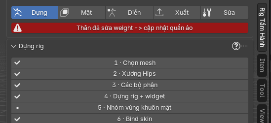
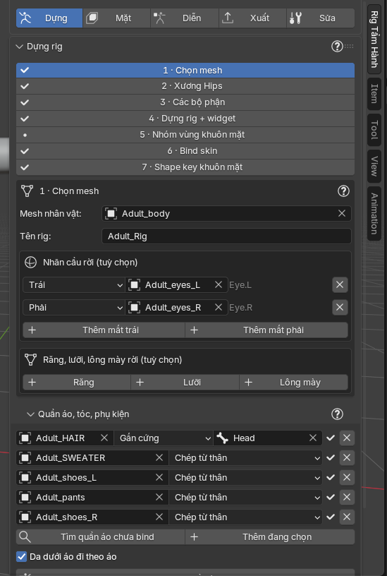
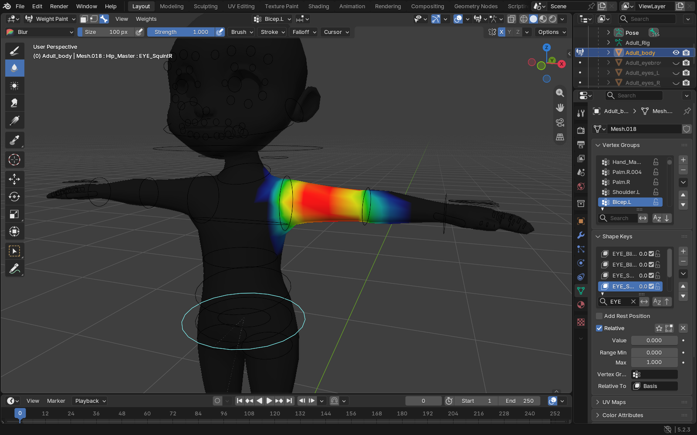
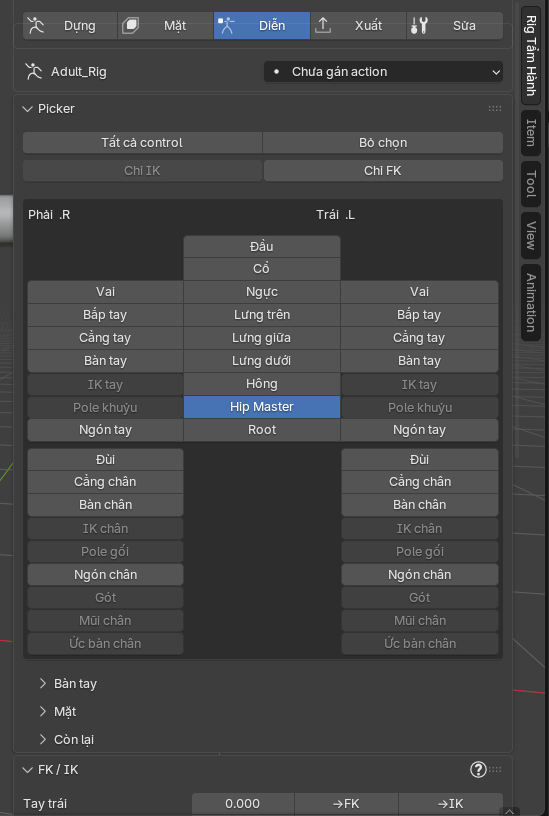
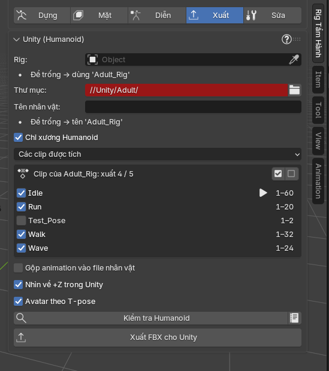

# Rig Tẩm Hành

Bộ công cụ rig nhân vật cho Blender: dựng rig từ bộ xương ref hoặc theo một nhân vật
mẫu đã rig sẵn, bind skin và quần áo, sửa và tối ưu weight, dựng shape key khuôn mặt,
công cụ diễn hoạt (picker, snap FK/IK, onion skin) và xuất sang Unity dạng Humanoid.
Chạy hoàn toàn offline, giao diện tiếng Việt.


## Tính năng chính

- **Dựng rig theo từng bước**: đặt bộ xương ref (thân, tay, bàn tay, chân, mặt, hàm, răng,
  lưỡi, môi, mũi, mắt, mí, mày, tai, chuỗi xương tự do) rồi dựng rig hoàn chỉnh — FK/IK,
  pole, công tắc, bone shape.
- **Khớp theo nhân vật mẫu**: có sẵn một nhân vật đã rig và tô weight? Addon tự khớp bộ
  xương, weight và shape key của nhân vật mẫu sang nhân vật mới.
- **Weight**: bind skin, lấp weight thiếu, dải chuyển hông / gối / khuỷu, **tối ưu weight
  bằng Delta Mush** (tối đa 4 xương mỗi vertex cho Unity), tự **giữ nguyên weight bạn vẽ
  tay**.
- **Quần áo, tóc, phụ kiện**: chép weight từ thân, gắn cứng vào xương, hoặc automatic;
  **cập nhật weight từ thân** sau mỗi lần sửa thân, có cảnh báo khi quần áo chưa cập nhật.
- **Shape key khuôn mặt**: dựng bộ shape key (âm vị, hàm, miệng, lưỡi, mắt, mày) từ xương
  mặt, biến pose thành shape key, đối xứng L↔R.
- **Face rig bằng bendy bone**: điều khiển mày, mí, môi bằng đường cong bendy bone kéo các
  xương mặt bên dưới — không cần shape key, xuất sang game engine như animation xương thường.
- **Diễn hoạt**: picker, chuyển và snap FK↔IK, bake theo đoạn, onion skin.
- **Xuất Unity Humanoid**: xuất FBX nhân vật + animation kèm bảng ánh xạ xương; script
  import cho Unity tự dựng Avatar, không cần map tay.
- **Sửa & kiểm tra**: khám rig, dựng lại driver/constraint, dọn bone shape, đổi tên xương
  trong action.

## Yêu cầu

- Blender 5.0 trở lên (đã dùng hằng ngày trên Blender 5.2, Windows).
- Unity 2022.3 trở lên nếu dùng phần xuất Humanoid.

## Cài đặt

1. Tải file `rig_tam_hanh-<phiên bản>.zip` ở mục **Releases** của repo.
2. Blender → **Edit → Preferences → Add-ons** → nút ⌄ góc phải → **Install from Disk…** →
   chọn file zip.
3. Tick bật **Rig Tẩm Hành**.
4. Trong cửa sổ 3D, bấm **N** để mở thanh bên, chọn tab **Rig Tẩm Hành**.

Cài từ mã nguồn: clone repo vào thư mục addons của Blender, **thư mục phải tên
`rig_tam_hanh`**:

```
git clone https://github.com/chupentamhanh/rig-tam-hanh.git "%APPDATA%\Blender Foundation\Blender\5.2\scripts\addons\rig_tam_hanh"
```

## Hướng dẫn sử dụng



**Thanh "Bước tiếp theo"** nằm ngay dưới thanh khu: nó nhắc việc nên làm tiếp — bước dựng rig
chưa xong, quần áo chưa bind, thân đã sửa weight mà quần áo chưa cập nhật, lông mày chưa bám
theo key mặt mới… — bấm vào là mở đúng chỗ hoặc làm luôn. Hết việc thì nó báo sẵn sàng xuất.

<br clear="right">

Tab **Rig Tẩm Hành** chia làm 5 khu, theo đúng thứ tự làm việc:
**Dựng → Mặt → Diễn → Xuất → Sửa**. Mỗi lúc chỉ hiện panel của một khu. Vào Pose Mode thì
addon tự chuyển sang khu Diễn. Nút **?** ở mỗi panel mở hướng dẫn ngắn ngay trong Blender.

### 1. Dựng rig

Khu **Dựng** là một danh sách 7 bước. Bước đã xong có dấu ✓; bấm vào một bước để mở nó.



**Bước 1 · Chọn mesh**

- Chọn mesh thân nhân vật và đặt tên cho rig.
- Nếu mắt là object riêng: thêm vào mục *Nhãn cầu rời* (trái / phải). Mắt sẽ được gắn cứng
  vào xương mắt thay vì skin như da.
- Răng, lưỡi, lông mày là mesh riêng: thêm vào mục bên dưới với đúng vai trò.

<br clear="right">


**Bước 2 · Xương Hips** — có hai cách:

- **Tạo bộ ref + xương Hips**: bắt đầu bộ xương ref từ đầu, đặt Hips vào giữa hông.
- **Lấy từ nhân vật mẫu đã rig** (nhanh nhất nếu bạn đã có một nhân vật cùng kiểu):
  1. Chọn *Rig mẫu* và *Mesh mẫu*.
  2. Bấm **Dựng ref theo nhân vật mẫu**. Addon khớp hình nhân vật mẫu lên nhân vật mới
     (báo độ lệch trung bình, thường khoảng 1 mm) và đặt toàn bộ xương ref theo đó: vai
     theo nách, hông theo đáy quần, mặt phẳng gập gối và khuỷu theo mẫu.
  3. Giữ bật *Bind: chép weight + shape key từ mẫu*: lúc bind, weight và shape key của
     mẫu được chép sang thay cho automatic weights.

<br clear="right">

**Bước 3 · Các bộ phận** — thêm từng bộ phận ref: thân, tay, bàn tay, chân, mặt (hoặc từng
phần mặt lẻ: hàm, răng, lưỡi, môi, mũi, mắt, mí, mày, tai) và chuỗi xương tự do (đuôi, tóc
dài…). Kéo các xương ref vào đúng chỗ trên mesh.

**Bước 4 · Dựng rig + widget** — sinh rig hoàn chỉnh: xương deform, FK/IK, pole, công tắc
FK/IK, bone shape tự ôm theo thân. Muốn chỉnh vị trí xương của rig đã dựng (kể cả sau khi
bind): bấm **Chỉnh lại vị trí xương của rig** ở bước 2, kéo xương ref, rồi áp lại — chỉ những xương
bạn đã di chuyển thay đổi, weight giữ nguyên.

**Bước 5 · Nhóm vùng khuôn mặt** *(tuỳ chọn)* — đánh dấu môi, mí, răng… để bước bind tô
weight mặt chính xác và bước 7 dựng shape key.


**Bước 6 · Bind skin**

- **Bind mesh thân**: skin mesh thân vào rig (automatic weights, hoặc chép từ nhân vật mẫu).
  Xương hàm, mắt, răng được tô riêng. Mesh đã bind rồi thì addon hỏi lại trước, vì bind lại
  sẽ tính lại toàn bộ weight (kể cả chỗ bạn đã vẽ tay).
- **Quần áo, tóc, phụ kiện**: bấm *Tìm quần áo chưa bind* hoặc *Thêm đang chọn*, chọn cách
  bind cho từng món:
  - *Chép từ thân* — áo, quần, giày: lấy weight của điểm gần nhất trên da, nên gập tay
    không bị đâm xuyên.
  - *Gắn cứng* — tóc ngắn, mũ, kính: 100% vào một xương.
  - *Automatic* — đồ rộng, xa thân.
- **Cập nhật quần áo**: một nút cho mọi việc với quần áo — bind món mới thêm vào và chép lại
  weight của thân sang áo, quần, giày, lông mày. Bấm sau khi thêm quần áo hoặc sửa weight thân;
  panel báo đỏ khi thân đã sửa mà quần áo chưa cập nhật. Hộp thoại có hai tuỳ chọn:
  - *Cả tóc*: tóc đang gắn cứng cũng chép weight từ thân (tóc dài chạm vai, gáy).
  - *Sửa da dưới áo theo áo (đổi weight thân)*: da bị áo che lấy weight của áo phía trên,
    chống đâm xuyên — tuỳ chọn này **có sửa weight thân** (trừ chỗ bạn vẽ tay). Tắt thì thân
    giữ nguyên tuyệt đối.

<br clear="right">

**Bước 7 · Shape key khuôn mặt** — xem khu Mặt bên dưới.

### 2. Weight: sửa, tối ưu, vẽ tay


Ở khu **Sửa → Trọng số skin**:

Mọi việc sửa weight thân nằm trong một menu **Sửa weight…** (mỗi mục có chú thích khi rê
chuột; các mục tính lại weight đều hỏi lại trước, kèm số vertex vẽ tay được giữ):

| Mục | Dùng khi |
|---|---|
| **Tự làm mượt weight các khớp** | Ngay sau khi bind. Cho nhân vật qua khoảng 40 tư thế, tìm weight để vai, nách, mông, khuỷu gập mượt hơn (cách tính "Delta Mush"). Tối đa 4 xương mỗi vertex cho Unity. |
| **Sửa hông, gối, khuỷu** | Háng gập thành khe, mông gãy khi giơ chân, khoeo/lòng khuỷu móp khi gập sâu. |
| **Sửa hông và gối (không đụng tay)** | Như trên nhưng không chạm vào tay. |
| **Rào weight theo vùng** | Xương lấn sang vùng không phải của nó: vai ăn lên má (nhún vai má bị kéo), hàm ăn ra sau gáy / xuống ngực (há miệng sau đầu bị kéo), đùi bên này ăn sang chân bên kia. Chỉ sửa vertex phạm luật, làm mượt chỗ vừa gỡ. |
| **Lấp chỗ thiếu weight** | Có vertex tổng weight < 1 (đứng yên khi pose). |

**Vùng weight & khám** (hộp ngay dưới menu):

- Mỗi xương deform thuộc một vùng — **Đầu, Thân, Tay trái/phải, Chân trái/phải** — lấy theo
  *cấu trúc rig*, không đoán theo tên: đầu và mọi xương con của nó; chuỗi tay / chân của rig
  cùng xương gốc chi (Shoulder, Pelvis); phần còn lại là thân. Một số "cầu nối" được sang vùng
  kề: cổ vào đầu, vai / đùi vào thân, xương thân chỗ chi bám vào chi, hai chân trộn nhau ở dải
  giữa háng, vai được ăn chỗ cổ giáp vai. Hàm chỉ được ăn phía trước khớp hàm, không lên đỉnh
  đầu, không xuống vai / ngực.
- Mỗi vertex thuộc vùng có tổng weight lớn nhất, tự tính ngay sau **Bind** (attribute
  `srp_region`). Vùng sai: vào Edit Mode của mesh thân, chọn vertex, bấm vùng đúng trong hộp.
- **Khám weight**: không sửa gì, ghi báo cáo vào text block `SRP_Weight_Check` — xương lấn
  vùng, chưa normalize, quá 4 xương, weight vụn, weight xa xương, lệch trái / phải; rồi cho
  nhân vật qua ~40 tư thế (tay, chân, lưng, cổ, há miệng) xem vùng nào bị kéo theo sai, cạnh
  lưới nào giãn quá mạnh.

Ngay bên dưới là nút **Cập nhật quần áo** (như ở bước 6).

<br clear="right">

**Vẽ tay được giữ nguyên.** Mỗi lần bạn vào Weight Paint (hoặc Edit Mode) rồi ra, addon ghi
nhận các vertex bạn đã đổi weight. Các nút sửa weight và bind quần áo sẽ **không ghi đè**
những vertex đó. Số vertex đang được giữ hiện ở cuối panel, kèm nút *Thôi giữ weight vẽ tay*
khi bạn muốn addon làm lại cả chỗ đó. Bind mesh lại từ đầu thì dấu này được xoá.



**Quy trình gợi ý cho nhân vật mới:**
Bind mesh thân → Sửa weight… / Tự làm mượt weight các khớp → vẽ tay chỗ còn chưa ưng →
Cập nhật quần áo.

### 3. Mặt — shape key hoặc bendy bone

Có hai cách điều khiển biểu cảm, dùng một trong hai (hoặc cả hai):

**Face rig bằng bendy bone** (không đụng tới shape key) — hộp đầu tiên trong khu *Mặt*:

- **Dựng**: mỗi đường mày, mí trên, mí dưới, môi trên, môi dưới thành một chuỗi bendy bone
  nối giữa vài control hình cầu (`FCtl_*`, collection *Face Controls*). Kéo control là đường
  cong uốn theo, các xương mặt đang skin (Eyebrow, Eyelid, Lip…) bám vào đúng một điểm trên
  đường cong. Góc mí và khoé miệng là control dùng chung của hai đường; môi dưới đi theo hàm,
  khoé miệng theo hàm một nửa.
- **Weight và tư thế nghỉ không đổi**: dựng xong mặt không xê dịch (lệch < 0.001 mm), không
  sửa một vertex weight nào.
- **Mí ôm nhãn cầu**: xương mí quay quanh tâm nhãn cầu thay vì trượt thẳng, và được đẩy ra
  một chút theo góc nhắm, nên nhắm mắt không bị nhãn cầu lòi qua da. Nhắm kín: kéo control
  mí trên xuống tới mí dưới, mí dưới lên khoảng 1/4.
- **Xuất game**: tắt *Chỉ xương Humanoid* khi xuất. Addon lấy mẫu từng frame các xương mặt
  thành animation xương thường (con của Head); control, bendy bone và xương cơ chế (`FBB_*`,
  `FSk_*`, `FMch_*`) không vào file FBX.
- **Gỡ**: trả xương mặt về cha cũ, xoá hết lớp điều khiển.

**Shape key khuôn mặt**:


- **Dựng bộ shape key**: sinh khoảng 56 shape key (âm vị `VIS_*`, hàm `JAW_*`, miệng
  `MTH_*`, lưỡi `TNG_*`, mắt `EYE_*`, mày `BRW_*`…) từ xương mặt, có chỉnh *Mức cường
  điệu*.
- **Kiểm định bộ shape key**: soi lỗi rách, gập lưới, nhãn cầu lộ khi chớp mắt.
- **Pose → Shape key**: pose xương mặt theo ý, bấm để lưu thành shape key mới (mesh phụ như
  lông mày đi theo bằng driver).
  - **Chỉ xương đang chọn**: chỉ lấy pose của những xương đang chọn, xương khác tạm về tư thế
    nghỉ lúc đo. Cách tách key trái / phải: pose cả hai bên → chọn các xương bên trái → nướng
    `..._L` → chọn các xương bên phải → nướng `..._R`. Nướng xong chỉ xương đã dùng về nghỉ,
    bên còn lại vẫn giữ pose. Hai key cộng lại đúng bằng key nướng cả hai bên cùng lúc.
    Tuỳ chọn tự bật khi bạn đang chọn một phần các xương đã pose.
- **Đối xứng shape key L ↔ R**: làm một bên, chép sang bên kia theo cặp vertex đối xứng.
- **Lông mày / râu rời bám da**: lông mày, râu, mi là mesh rời thì chỉ đi theo những key nó có. Nút này
  neo từng vertex của mesh phụ vào da bên dưới và dựng lại shape key cho nó theo **mọi** key của
  mặt (key thiếu thì tạo, kèm driver), nên khi thử biểu cảm hay chạy animation, lông mày luôn
  dán trên da. Chọn mesh phụ rồi bấm; không chọn gì thì addon lấy lông mày của nhân vật.
  **Dựng bộ shape key** và **Pose → Shape key** tự làm bước này luôn; tự sửa / thêm key mặt bằng
  tay thì thanh "Bước tiếp theo" nhắc bấm lại. *Làm mượt* > 0 nếu muốn lông mày bớt giãn theo da.
- **Thử biểu cảm**: bấm thử các biểu cảm mẫu (vui, buồn, ngạc nhiên…).

<br clear="right">

### 4. Diễn — animate



- **Picker**: bấm để chọn control theo sơ đồ cơ thể, bàn tay, mặt.
- **FK / IK**: kéo công tắc từng chi; **→FK / →IK** snap tư thế sang chế độ kia mà nhân
  vật không nhúc nhích.
- **Bake theo đoạn**: bake cả action — FK theo IK, hoặc IK theo FK.
- **Công cụ**: ghi key, nhảy key, lật pose sang bên kia, chọn bên kia, reset (đang chọn /
  cả rig), tween 25–75%.
- **Onion skin**: hiện bóng các frame trước / sau.

<br clear="right">

### 5. Xuất — Unity Humanoid



1. Chọn rig, thư mục xuất (chọn thẳng một thư mục trong `Assets/` của project Unity là
   tiện nhất) và tên nhân vật.
2. **Mesh xuất**: *Mọi mesh của rig*, *Mesh đang chọn*, *Mesh đang hiện* (đang ẩn thì bỏ)
   hoặc *Mesh trong collection*. Dòng bên dưới liệt kê mesh sẽ vào file. Khung xương luôn đủ.
3. Chọn clip: để *Các clip được tích*, danh sách bên dưới hiện mọi animation clip có **slot**
   dành cho rig (slot rig đang dùng, slot trùng tên rig, hoặc slot có kênh trỏ vào xương của rig),
   kèm khoảng frame. Tích clip nào thì clip đó được xuất; hai nút ☑ / ☐ để tích hết / bỏ hết.
   Lựa chọn lưu ngay trên từng action nên mở lại file vẫn nhớ. Mặc định mọi clip đều được tích.
   **Theo bộ action** (giống action collection): tạo các bộ có tên (Locomotion, Combat…), thêm
   action vào từng bộ (nút +, hoặc *Thêm các clip đang tích*). Mỗi bộ được tích ra một file
   `<tên>@<bộ>.fbx`, mỗi action một take; Unity tự đặt tên clip theo action. Bộ lưu trên rig.
4. **Kiểm tra Humanoid**: báo xương nào thiếu hay sai trước khi xuất, kèm clip nào sẽ bị bỏ.
5. **Xuất FBX cho Unity**: ra `<tên>.fbx` (mô hình), `<tên>@<action>.fbx` (mỗi animation một
   file, hoặc *Gộp animation vào file nhân vật*), `<tên>.humanoid.json` (bảng ánh xạ) và
   script `RigTamHanhHumanoidImporter.cs`.
6. Nếu thư mục xuất nằm trong project Unity, script tự vào `Assets/Editor/RigTamHanh`; không
   thì chép nó vào một thư mục `Editor` bất kỳ. Unity import FBX thành Humanoid với đúng bảng
   ánh xạ — không dùng auto-map.

**Avatar theo T-pose** (mặc định bật): Avatar lấy T-pose làm tư thế tham chiếu — tay,
bàn tay, ngón thẳng ngang, chân thẳng đứng — như nút *Enforce T-Pose* của Unity, nên animation
retarget sang không bị lệch góc. Mô hình vẫn giữ đúng dáng trong Blender.

Script import dựng Avatar sau khi Unity import xong cả đợt, nên chạy đúng cả khi Unity import
song song (AssetImportWorker), khi json tới sau FBX, hay khi file animation import trước mô
hình. Project chỉ nên có một script import Humanoid: còn script khác (bản cũ) thì Unity hỏi
xoá. Avatar hỏng thì Console báo; làm lại tay: chọn FBX → *Assets → Rig Tẩm Hành → Dựng lại
Avatar Humanoid*.

Mặc định chỉ xuất xương Humanoid; weight của xương phụ dồn về xương Humanoid gần nhất.
Unity mặc định dùng tối đa 4 xương mỗi vertex (Project Settings → Quality → Skin Weights).

<br clear="right">

### 6. Sửa & kiểm tra

- **Driver & rig logic → Áp lại**: dựng lại driver/constraint của rig nếu bị hỏng (file
  hỏng được quét tự động khi mở).
- **Khám rig đầy đủ**: kiểm tra toàn bộ rig, ghi báo cáo ra khối text `RigTamHanh_KhamRig`.
- **Dọn bone shape**, **Đổi tên xương trong action**, **Đổi kết quả solve**.

## Phát triển

- Lịch sử thay đổi kèm số đo: [`CHANGELOG.md`](CHANGELOG.md).
- Bộ test: [`tests/README.md`](tests/README.md). Chạy tất cả bằng một lệnh:
  `python tests/run_tests.py`.

## Maintainer

**Chú Pen Tẩm Hành**
